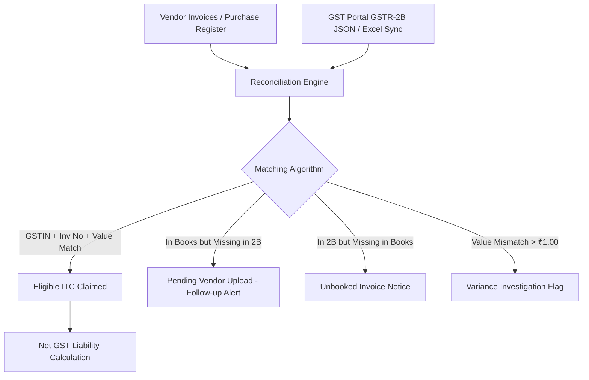
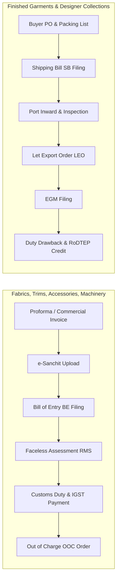

# 🏛️ Rivlet Enterprise: Compliance Hub, ICEGATE Customs, GST Engine & Unified Calendar Master Plan

> **Architectural Blueprint, Technical Specification & Feasibility Roadmap**  
> Tailored for **Rivlet Apparel & Manufacturing Operations**  
> Status: **FINALIZED & READY FOR IMPLEMENTATION**  
> Target Integration: **Rivlet Admin Console (`/compliance`, `/calendar`, `/work`)**  

---

## 📌 Executive Summary & Scope

Rivlet requires an enterprise-grade compliance management ecosystem and an interactive operational calendar. As a high-end clothing and textile manufacturing brand with international sourcing and domestic distribution, Rivlet manages complex statutory obligations:
1. **GST Compliance & ITC Reconciliation**: Monthly/quarterly filing of GSTR-1 and GSTR-3B, automated tax liability calculations, and Input Tax Credit (ITC) reconciliation against vendor bills (GSTR-2B / IMS).
2. **ICEGATE & Customs Clearance**: Import operations for specialty fabrics, yarns, trims, and knitting machinery via **Bills of Entry (BOE)**; export operations for ready-to-wear collections via **Shipping Bills (SB)**, incentive tracking (Duty Drawback, RoDTEP/RoSCTL), and e-Sanchit document management.
3. **DSC & ITR Lifecycle Tracking**: Digital Signature Certificate (Class 3) token expiration monitors, Advance Tax tranches, TDS quarterly filings, and corporate Income Tax Returns.
4. **Zero-Knowledge Password & Credential Vault**: Secure, client-masked storage for statutory credentials (PAN, TAN, GSTIN, ICEGATE, DGFT, Bank AD Codes, TRACES).
5. **Interactive Operations Calendar**: ADO/Google Calendar-grade unified scheduler rendering compliance deadlines, customs milestones, sprint cadences, and reminder notifications across Month, Week, Day, and Agenda views.
6. **Navigation Streamlining**: Clean reorganization of the sidebar navigation to eliminate redundancy while preserving deep tab access.

---

## 🗺️ Master Navigation Architecture

### 1. Reorganized Sidebar Menu (`Sidebar.tsx`)
```
Rivlet Admin Navigation
├── 🏠 Dashboard & Focus (/)
├── 📋 Work Tracking (/work)
│   ├── Backlogs (/work?tab=backlog)
│   ├── Sprint Board (/work?tab=board)
│   └── Sprints (/work?tab=sprints)
│   └── [REMOVED FROM SIDEBAR: "Sprint Bulk Creation" & "Teams"]
│       * Note: Accessible directly within the /work page header tabs
├── ⚖️ Compliance (/compliance)  [NEW TOP-LEVEL MODULE]
│   ├── Overview & Workflows (/compliance?tab=workflows)
│   ├── GST Engine & ITC Tracker (/compliance?tab=gst)
│   ├── IEC & ICEGATE Customs (/compliance?tab=icegate)
│   ├── ITR & Direct Tax (/compliance?tab=itr)
│   ├── DSC Token Registry (/compliance?tab=dsc)
│   └── Secure Credential Vault (/compliance?tab=vault)
├── 📅 Calendar (/calendar)  [NEW TOP-LEVEL MODULE]
│   ├── Month View
│   ├── Week View
│   ├── Day Hourly Grid
│   └── Agenda / Deadline List
├── 🏭 Vendors & Mills Ecosystem (/vendors)
├── 🌿 Sampling & Production Pipeline (/pipeline)
├── 💰 Budget & Cash Inflows (/budget)
├── 🧮 Garment Pricing Engine (/calculator)
├── 📁 Document Vault (/documents)
├── 📖 Brand Knowledge Base (/knowledge-base)
└── ⚙️ Access & Audit (/access, /audit)
```

---

## 🏛️ Module 1: Compliance Management Engine (`/compliance`)

### 1.1 Executive Telemetry Header (Dashboard at the Top)
At the top of `/compliance`, an executive pulse dashboard renders real-time KPI metrics:
- **Statutory Filing Health**: Overall compliance score (e.g., `98% On-Time`, `0 Overdue`).
- **Upcoming Deadlines (Next 7 / 30 Days)**: Countdown cards with amber/red urgency badges for GSTR-1, GSTR-3B, Advance Tax, and BOE payments.
- **Unclaimed GST ITC (Input Tax Credit)**: Live aggregate of available credit eligible for set-off in the current cycle vs pending supplier upload.
- **Active Digital Signatures**: Count of active Class 3 tokens with warning flags for tokens expiring within 30 days.
- **Customs In-Transit Clearance**: Count of active Bills of Entry / Shipping Bills awaiting Assessment, Duty Payment, or OOC/LEO.

### 1.2 Universal Compliance Workflow Tracker
The core matrix displays all statutory filings across entities, brands, and periods:
| Field | Type | Description |
|---|---|---|
| **Workflow ID & Title** | String | e.g., `GSTR-1 Oct 2026 - Rivlet Apparel Corp` |
| **Client / Entity** | String | Brand entity, branch, or subsidiary GSTIN |
| **Return Type & Period** | Enum / String | GSTR-1, GSTR-3B, ITR-6, 26Q TDS, ICEGATE BOE, DSC Renewal |
| **Statutory Due Date** | Date | Statutory cutoff date (e.g., 10th or 20th of the month) |
| **Status** | Enum | `Upcoming`, `In Progress`, `Filed`, `Pending Review`, `Overdue` |
| **Assignee / Owner** | String / User | Internal CA, Compliance Officer, or CHA Agent |
| **ARN / Challan No** | String | Acknowledgment Reference Number / Duty Challan receipt |
| **Attachment Link** | File URL | Filed PDF return receipt or assessment order |
| **Actions** | Action Menu | Mark Filed, Edit, Trigger Manual Reminder, Log Audit |

---

## 📊 Module 2: GST Engine, Reminders & ITC Tracker (`/compliance?tab=gst`)

### 2.1 Statutory Deadlines & Configurable Cadence
- **GSTR-1 (Outward Supplies / Sales)**:
  - Default Due Date: **10th of every month** (Statutory deadline 11th; 10th ensures buffer for portal traffic).
- **GSTR-3B (Summary Return & Tax Settlement)**:
  - Default Due Date: **20th of every month** (Statutory cutoff for monthly filers).
- **Filing Frequency Setting**:
  - Global toggle in Compliance Settings: **Monthly (Active Default)** vs **Quarterly (QRMP Scheme)**.
  - When Quarterly is selected, GSTR-1 becomes quarterly IFF (Invoice Furnishing Facility) for months 1 & 2 (13th of next month) and full GSTR-1 on the 13th following the quarter; GSTR-3B shifts to the 22nd/24th.

### 2.2 Multi-Tier Proactive Reminder Engine
Automated multi-cadence reminders run through `notificationStorage.ts` and in-app toasts:
- **T-7 Days (Preparation Alert)**: Prompts accounting team to complete sales ledger locks and import vendor purchase registers.
- **T-3 Days (Reconciliation Alert)**: Flags any discrepancy between internal books and GSTR-2B.
- **T-1 Day (Final Review Alert)**: Verifies that return JSON is generated and approved.
- **Due Date (Urgent Cutoff Alert - 09:00 AM)**: Immediate reminder to file before portal midnight cutoff to prevent late fees (Section 47: ₹50/day) and interest (Section 50: 18% p.a.).
- **Overdue Notice (T+1 Day & Daily)**: Escalation alert with accumulated penalty counter.

### 2.3 GST ITC (Input Tax Credit) Reconciliation Engine
Modeled after leading enterprise tools (ClearTax, Zoho Books):

1. **Rule 88A Tax Offset Sequence**:
   - Integrated calculator strictly follows Indian GST Section 49 / Rule 88A:
   - Output IGST cleared first by Input IGST, then Input CGST, then Input SGST.
   - Output CGST cleared by balance Input IGST, then Input CGST.
   - Output SGST cleared by balance Input IGST, then Input SGST.
   - Displays clear breakdown of **Total Output Tax**, **Eligible ITC Set-Off**, and **Net Cash Payable via PMT-06 Challan**.
2. **Blocked Credit Identification (Section 17(5))**:
   - Automatic tagging for non-claimable items (e.g., motor vehicles, food & beverages, personal consumption) to safeguard against tax audit notices.

---

## 🚢 Module 3: ICEGATE & Customs Clearance for Rivulet Apparel (`/compliance?tab=icegate`)

As an apparel manufacturing & design house, Rivlet’s trade footprint involves two distinct cross-border tracks:



### 3.1 Apparel Customs Planner Sheet & Stage Pipeline
The ICEGATE dashboard provides an interactive spreadsheet/Kanban matrix tracking every consignment:
1. **Consignment Metadata**:
   - Port of Entry/Exit (e.g., INMAA1 - Chennai Sea, INBLR4 - Bangalore Air Cargo, INNSA1 - Nhava Sheva).
   - CHA (Customs House Agent) Partner & Contact.
   - HSN Classification (Chapter 50-60 for fabrics, Chapter 61 for knitted apparel, Chapter 62 for woven apparel, Chapter 84 for sewing/cutting machinery).
   - Currency & Exchange Rate (CBIC statutory notification exchange rate).
2. **e-Sanchit Digital Document Checklist**:
   - Commercial Invoice & Packing List (PDF signable).
   - Bill of Lading (BL) / Airway Bill (AWB).
   - Certificate of Origin (COO / Preferential FTA for duty concessions).
   - Textile Testing Lab Report (Azo dyes compliance, fiber composition cert).
   - Generates and tracks document Image Reference Numbers (IRN).
3. **Duty & Tax Ledger**:
   - Basic Customs Duty (BCD).
   - Agriculture Infrastructure and Development Cess (AIDC) / Social Welfare Surcharge (SWS 10%).
   - Integrated GST (IGST) paid on import (which automatically flows into the GST ITC Ledger).
   - Export Incentives: All Industry Rate (AIR) Duty Drawback tracking & RoDTEP/RoSCTL scrip ledger.

---

## 🔐 Module 4: Digital Signature Certificate (DSC) & Direct Tax (ITR)

### 4.1 Digital Signature Certificate (DSC) Registry (`/compliance?tab=dsc`)
- **Key Fields**: Token Holder Name, Role/Designation, Certificate Authority (eMudhra, Vsign, Capricorn, Sify), Class (Class 3 Signing & Encryption), USB Token Serial Number, Expiry Date, Hardware Token Location.
- **Renewal Alert Cadence**: 60 days, 30 days, 15 days, 7 days prior to expiry.
- **Filing Portals Bound**: Tracks which portals map this DSC (MCA/ROC, Income Tax, GSTN, ICEGATE, DGFT).

### 4.2 Income Tax Returns & Statutory Direct Tax (`/compliance?tab=itr`)
- **Advance Tax Schedule Reminders**:
  - 1st Installment (15%): Due **June 15**
  - 2nd Installment (45% cumulative): Due **September 15**
  - 3rd Installment (75% cumulative): Due **December 15**
  - 4th Installment (100%): Due **March 15**
- **TDS Quarterly Filings (Form 24Q - Salary / Form 26Q - Vendor Payments)**:
  - Q1 (Due July 31), Q2 (Due October 31), Q3 (Due January 31), Q4 (Due May 31).
- **Tax Audit & Annual ITR Filing**:
  - Tax Audit Report (Form 3CA/3CD): Due **September 30 / October 31**.
  - Corporate ITR-6 Filing: Due **October 31**.

---

## 🛡️ Module 5: Secure Credential & Password Vault (`/compliance?tab=vault`)

Enterprise operations require secure, shared yet governed access to government portal credentials.
1. **Protected Asset Types**:
   - Permanent Account Number (PAN) & Tax Deduction Account Number (TAN).
   - GSTIN Portal User ID, Password, and API Client Credentials.
   - ICEGATE User ID, Password, Digital Signature PIN.
   - DGFT Portal Login & AD Code bank mappings.
   - EPFO / ESIC / Professional Tax credentials.
2. **Security Controls**:
   - Client-side master masking (`••••••••••••`) with one-click copy to clipboard.
   - Reveal password guarded by user authorization / PIN verification.
   - Role-Based Access Control (RBAC): Only `owner`, `admin`, and `compliance_lead` can view or edit sensitive portal credentials.
   - Immutable audit logging on every view, reveal, or modification.

---

## 📅 Module 6: Interactive Operations Calendar (`/calendar`)

Modeled after modern productivity suites (Azure DevOps Boards, Google Calendar, Microsoft Teams Calendar):

```
+----------------------------------------------------------------------------------------------------+
| 📅 Operations Calendar              [ < Today > ] [ October 2026 ]        [ Month | Week | Day | Agenda ] |
| Filter: [x] Compliance  [x] GST  [x] Customs ICEGATE  [x] Sprints/Work  [x] DSC Expiry  [+ Add Event] |
+----------------------------------------------------------------------------------------------------+
| Mon               | Tue               | Wed               | Thu               | Fri                |
| 5                 | 6                 | 7                 | 8                 | 9                  |
|                   |                   | 🚢 BE-10842 RMS   |                   | 🔔 GSTR-1 Prep Call|
+-------------------+-------------------+-------------------+-------------------+--------------------+
| 12                | 13                | 14                | 15                | 16                 |
|                   |                   |                   | 💼 Advance Tax Q2 |                    |
+-------------------+-------------------+-------------------+-------------------+--------------------+
| 19                | 20                | 21                | 22                | 23                 |
|                   | 🔴 GSTR-3B DUE    |                   |                   |                    |
+----------------------------------------------------------------------------------------------------+
```

### 6.1 View Capabilities
- **Month Grid View**: Traditional calendar grid displaying multi-day sprint ranges and date badges.
- **Week Column View**: Day columns with time-slot intervals for scheduled calls, filings, and CHA meetings.
- **Day Hourly View**: High-detail operational day planner.
- **Agenda / Table View**: Searchable list sorted chronologically with category filters and status pills.

### 6.2 Interactive Event Modals & Popovers
Clicking any calendar event opens a rich modal:
- **Title, Category Badge & Urgency Indicator**.
- **Associated Module Deep Link**: Direct jump button to `/compliance?tab=gst` or `/work?tab=board`.
- **Filing Details**: Tax period, amount payable, ARN number, or CHA tracking link.
- **Quick Action Buttons**: "Mark as Completed", "Download Challan Receipt", "Snooze Reminder".
- **iCal / Google Calendar Export**: Export any statutory deadline to `.ics` format.

---

## 🗄️ Database Architecture & Supabase Schema

A new migration `supabase_migration_v15_compliance_and_calendar.sql` will provide persistent, multi-tenant state:

```sql
-- 1. Compliance Workflows & Filings Matrix
CREATE TABLE IF NOT EXISTS public.compliance_workflows (
    id UUID PRIMARY KEY DEFAULT gen_random_uuid(),
    title TEXT NOT NULL,
    category TEXT NOT NULL CHECK (category IN ('gst', 'icegate', 'itr', 'dsc', 'tds', 'other')),
    entity_name TEXT NOT NULL,
    return_type TEXT NOT NULL,
    tax_period TEXT NOT NULL,
    due_date DATE NOT NULL,
    statutory_deadline DATE NOT NULL,
    status TEXT NOT NULL DEFAULT 'upcoming' CHECK (status IN ('upcoming', 'in_progress', 'filed', 'pending_review', 'overdue')),
    assigned_to TEXT,
    arn_number TEXT,
    challan_amount NUMERIC(12, 2) DEFAULT 0,
    itc_claimed NUMERIC(12, 2) DEFAULT 0,
    attachment_url TEXT,
    notes TEXT,
    created_at TIMESTAMPTZ DEFAULT NOW(),
    updated_at TIMESTAMPTZ DEFAULT NOW()
);

-- 2. GST Configuration & ITC Reconciliations
CREATE TABLE IF NOT EXISTS public.gst_settings (
    id UUID PRIMARY KEY DEFAULT gen_random_uuid(),
    gstin TEXT UNIQUE NOT NULL,
    legal_name TEXT NOT NULL,
    trade_name TEXT,
    filing_frequency TEXT NOT NULL DEFAULT 'monthly' CHECK (filing_frequency IN ('monthly', 'quarterly')),
    gstr1_due_day INT DEFAULT 10,
    gstr3b_due_day INT DEFAULT 20,
    reminder_days INT[] DEFAULT '{7, 3, 1, 0}',
    is_active BOOLEAN DEFAULT true,
    created_at TIMESTAMPTZ DEFAULT NOW()
);

-- 3. ICEGATE Customs Declarations (Apparel Imports & Exports)
CREATE TABLE IF NOT EXISTS public.customs_declarations (
    id UUID PRIMARY KEY DEFAULT gen_random_uuid(),
    declaration_type TEXT NOT NULL CHECK (declaration_type IN ('import_boe', 'export_sb')),
    declaration_number TEXT NOT NULL,
    declaration_date DATE NOT NULL,
    port_code TEXT NOT NULL,
    port_name TEXT NOT NULL,
    hsn_chapter TEXT NOT NULL,
    goods_description TEXT NOT NULL,
    invoice_value_inr NUMERIC(14, 2) NOT NULL,
    customs_duty_inr NUMERIC(12, 2) DEFAULT 0,
    igst_paid_inr NUMERIC(12, 2) DEFAULT 0,
    drawback_claimed_inr NUMERIC(12, 2) DEFAULT 0,
    rodtep_claimed_inr NUMERIC(12, 2) DEFAULT 0,
    cha_name TEXT,
    current_stage TEXT NOT NULL CHECK (current_stage IN ('draft', 'filed', 'rms_assessment', 'duty_paid', 'under_examination', 'cleared_ooc_leo', 'rejected')),
    esanchit_irn_list TEXT[],
    created_at TIMESTAMPTZ DEFAULT NOW(),
    updated_at TIMESTAMPTZ DEFAULT NOW()
);

-- 4. Digital Signature Certificate (DSC) Registry
CREATE TABLE IF NOT EXISTS public.dsc_registry (
    id UUID PRIMARY KEY DEFAULT gen_random_uuid(),
    token_label TEXT NOT NULL,
    holder_name TEXT NOT NULL,
    designation TEXT NOT NULL,
    cert_authority TEXT NOT NULL,
    serial_number TEXT UNIQUE NOT NULL,
    issued_date DATE NOT NULL,
    expiry_date DATE NOT NULL,
    token_location TEXT,
    status TEXT NOT NULL DEFAULT 'active' CHECK (status IN ('active', 'expiring_soon', 'expired', 'revoked')),
    created_at TIMESTAMPTZ DEFAULT NOW()
);

-- 5. Secure Credential Vault (Encrypted)
CREATE TABLE IF NOT EXISTS public.credential_vault (
    id UUID PRIMARY KEY DEFAULT gen_random_uuid(),
    title TEXT NOT NULL,
    service_type TEXT NOT NULL CHECK (service_type IN ('gst', 'icegate', 'dgft', 'incometax', 'traces', 'bank_ad', 'other')),
    identifier TEXT NOT NULL, -- e.g., PAN / GSTIN / Username
    encrypted_secret TEXT NOT NULL, -- Salted/AES encrypted or masked token
    portal_url TEXT,
    notes TEXT,
    last_verified_at TIMESTAMPTZ,
    updated_at TIMESTAMPTZ DEFAULT NOW()
);

-- 6. Unified Calendar Events (Synced with Work & Compliance)
CREATE TABLE IF NOT EXISTS public.calendar_events (
    id UUID PRIMARY KEY DEFAULT gen_random_uuid(),
    title TEXT NOT NULL,
    description TEXT,
    start_time TIMESTAMPTZ NOT NULL,
    end_time TIMESTAMPTZ NOT NULL,
    all_day BOOLEAN DEFAULT true,
    event_category TEXT NOT NULL CHECK (event_category IN ('gst', 'customs', 'itr', 'dsc', 'sprint', 'vendor', 'general')),
    priority TEXT NOT NULL DEFAULT 'medium' CHECK (priority IN ('low', 'medium', 'high', 'critical')),
    related_entity_id UUID,
    related_link TEXT,
    status TEXT NOT NULL DEFAULT 'pending' CHECK (status IN ('pending', 'in_progress', 'completed', 'overdue')),
    created_at TIMESTAMPTZ DEFAULT NOW()
);
```

---

## 🚀 Step-by-Step Implementation Roadmap

```
Wave 1: Navigation Refactor & Structural Setup
├── Task 1.1: Edit Sidebar.tsx to remove "Sprint Bulk Creation" and "Teams" from Work Tracking sub-items.
├── Task 1.2: Add "Compliance" with sub-navigation flyouts (GST, ICEGATE, ITR, DSC, Vault, Workflows).
├── Task 1.3: Add "Calendar" top-level navigation item with active route indicators.
└── Task 1.4: Update permissions.ts & types.ts with new modules: `compliance` and `calendar`.

Wave 2: Database Migration & Core Data Utilities
├── Task 2.1: Create supabase_migration_v15_compliance_and_calendar.sql with all tables, constraints, and RLS policies.
├── Task 2.2: Add initial seed data (Rivlet GSTINs, active apparel Bills of Entry & Shipping Bills, upcoming deadlines, active DSCs).
└── Task 2.3: Implement durable local/Supabase sync helpers for compliance records and calendar events.

Wave 3: Compliance Hub (`/compliance`) & GST Engine
├── Task 3.1: Build Compliance Telemetry Cards (Filing Health Score, Next 7/30 days, Unclaimed ITC, DSC alerts).
├── Task 3.2: Build Compliance Workflow Data Grid (sorting, filtering, add workflow modal, mark filed, ARN recorder).
├── Task 3.3: Implement GST Engine tab:
│   ├── GSTR-1 & GSTR-3B monthly/quarterly setting switchers
│   ├── Automated calculation of output liability vs eligible input credit
│   ├── Rule 88A tax offset sequence visualizer
│   └── Multi-cadence reminder generator (T-7, T-3, T-1, Due day)
└── Task 3.4: Build DSC Tracker & ITR schedule views with automated expiration alerts.

Wave 4: ICEGATE Customs Clearance Planner for Apparel
├── Task 4.1: Build Apparel Customs Planner Sheet (Interactive matrix for Bills of Entry & Shipping Bills).
├── Task 4.2: Implement e-Sanchit document upload checklist & IRN logger.
├── Task 4.3: Implement Port & CHA tracking with live stage status (RMS, Duty Paid, OOC/LEO).
└── Task 4.4: Add Duty Drawback & RoDTEP export incentive tracker.

Wave 5: Secure Credential & Password Vault
├── Task 5.1: Build Credential Vault UI with category grouping (GST, ICEGATE, DGFT, Income Tax).
├── Task 5.2: Implement client-side secret masking, copy-to-clipboard, and reveal authorization.
└── Task 5.3: Add immutable audit logging for credential reveals and edits.

Wave 6: Interactive Operations Calendar Module (`/calendar`)
├── Task 6.1: Build Calendar Header with View Switcher (Month, Week, Day, Agenda) and Month/Year picker.
├── Task 6.2: Build Month Grid View with multi-event stacking, overflow badges, and current day highlight.
├── Task 6.3: Build Week & Day View with time slots and interactive event placing.
├── Task 6.4: Build Agenda / Schedule View with category color coding and quick filters.
├── Task 6.5: Build Event Details Popover & Quick Action Drawer (links to Compliance/Work).
└── Task 6.6: Add .ICS export for syncing with Google Calendar, Microsoft Teams, and Apple Calendar.

Wave 7: Verification & Quality Assurance
├── Task 7.1: Verify navigation responsiveness on both desktop and mobile drawer views.
├── Task 7.2: Verify GST calculation accuracy against statutory Rule 88A test vectors.
├── Task 7.3: Test reminder delivery across in-app notification bell and banner alerts.
└── Task 7.4: Validate end-to-end build with `npm run build` and capture empirical proof.
```

---

## 🛡️ Feasibility Assessment & Risk Mitigation

| Dimension | Risk / Challenge | Feasibility Strategy |
|---|---|---|
| **Statutory Rules Accuracy** | Changes in CBIC due dates or quarterly rules | Configurable settings allow altering due days (e.g. 10th to 11th) and frequency without code alterations. |
| **Credential Security** | Exposure of government portal passwords in browser state | Passwords default to masked hashes; audit log records every click; strictly restricted to `owner`/`admin` roles. |
| **Calendar Performance** | Rendering hundreds of compliance events and sprint tasks across months | Virtualized date rendering and memoized event selectors avoid re-rendering inactive cells. |
| **Mobile Responsiveness** | Complex compliance tables and multi-view calendars on small screens | Horizontal scroll wrappers, mobile card representations, and native touch swipe support in calendar. |
| **Offline Resilience** | Intermittent connection to Supabase during warehouse/port visits | LocalStorage durable backup fallback ensures continuous operation without data loss. |

---

*This blueprint provides the complete, unambiguous foundation for pair programming execution.*
